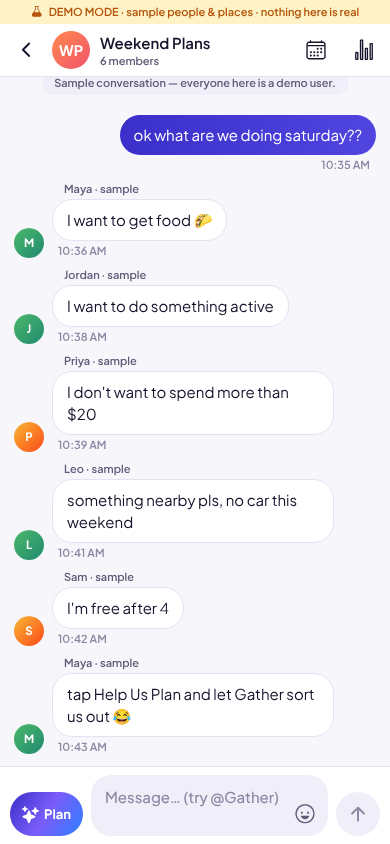
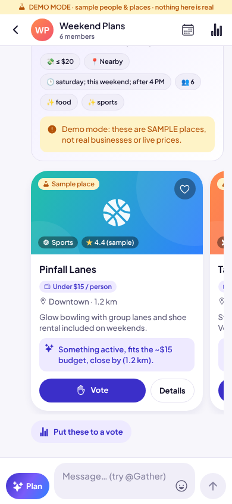
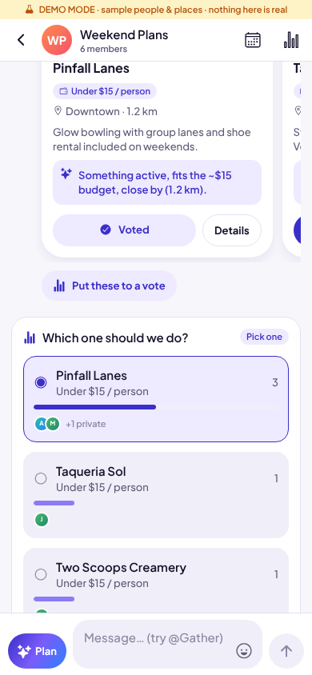
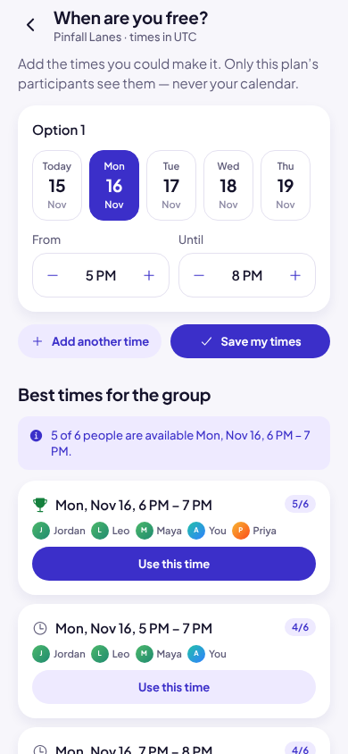
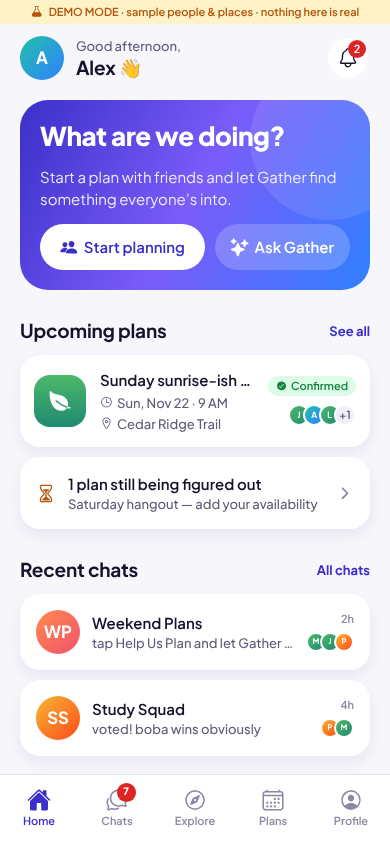
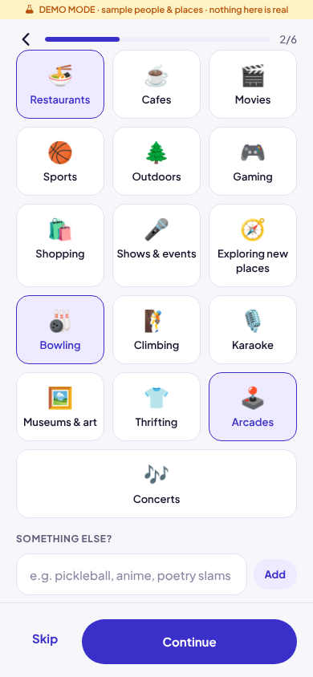
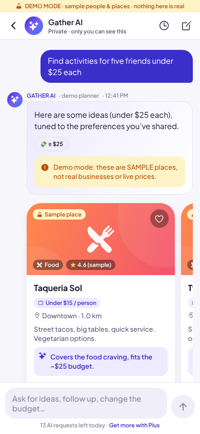
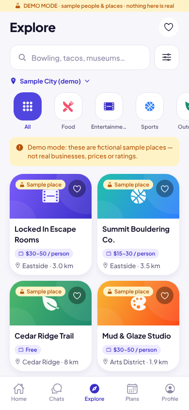
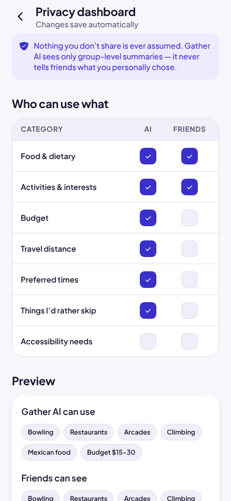
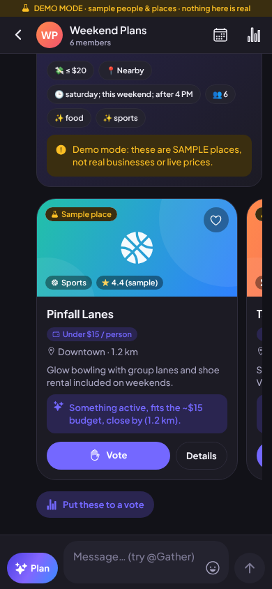

# Gather

**Less planning. More doing.**

Gather is a social planning app for friend groups. It combines a group chat with an AI planning assistant that reads the conversation, respects what each person has chosen to share (interests, budget, distance, times), and suggests options the group can vote on, schedule and turn into a plan.

It's built as a social app first and an AI app second: Gather AI never interrupts a chat unless someone asks (the ✨ **Plan** button or `@Gather`), or the group explicitly opts in to rate-limited automatic suggestions.

| Group chat | Gather AI suggestions | Live voting | Availability matching |
|---|---|---|---|
|  |  |  |  |

| Home | Onboarding | Private assistant | Explore | Privacy dashboard | Dark mode |
|---|---|---|---|---|---|
|  |  |  |  |  |  |

*Screenshots are from demo mode (sample people and places), taken automatically by the end-to-end test.*

---

## Contents

1. [Quick start (demo mode, no accounts needed)](#quick-start-demo-mode)
2. [What works today](#feature-status)
3. [Technology stack](#technology-stack)
4. [Project structure](#project-structure)
5. [Connecting Supabase (accounts, realtime, storage)](#connecting-supabase)
6. [Enabling Gather AI and place search](#enabling-gather-ai-and-place-search)
7. [Environment variables](#environment-variables)
8. [Testing](#testing)
9. [Demo mode](#demo-mode)
10. [Privacy, safety and security](#privacy-safety-and-security)
11. [Premium (freemium) design](#premium-design)
12. [Future improvements](#future-improvements)

Further reading: [`docs/ARCHITECTURE.md`](docs/ARCHITECTURE.md) · [`docs/DEPLOYMENT.md`](docs/DEPLOYMENT.md) (App Store / Google Play)

---

## Quick start (demo mode)

Requirements: **Node 20+** and npm. For a phone, install **Expo Go** — or use a development build (see [Deployment](docs/DEPLOYMENT.md)).

```bash
npm install
```

```bash
npx expo start
```

Then press `i` (iOS simulator), `a` (Android emulator), `w` (web), or scan the QR code with your phone. On the welcome screen tap **Explore the demo**.

Suggested walkthrough (also inside the app: Profile → *About demo mode*):

1. Finish onboarding (pick a username, a few interests, budget, privacy choices).
2. **Chats → Weekend Plans.** Five sample friends already said what they want ("food", "something active", "under $20", "nearby", "free after 4").
3. Tap **✨ Plan → Get suggestions** (or type `@Gather what should we do?`).
4. Swipe the recommendation cards, tap **Vote** on one. A poll is created and sample friends vote in real time.
5. **Close poll & pick winner → Make it a plan.**
6. **Add availability**. Friends' times are pre-filled; Gather finds the overlap ("Everyone is available …"). **Use this time → Confirm plan.**
7. The plan shows in **Plans → Upcoming**.
8. From Home, open **Ask Gather** (private assistant), ask for ideas, ♥ save one, share it to a group, or tap **Plan it**.

Demo data is stored only on the device and can be reset with *Exit demo*.

## Feature status

✅ = works end-to-end today · 🔑 = implemented, needs your credentials to run live · 🗓️ = designed for, not built yet

| Area | Status | Notes |
|---|---|---|
| Auth: sign up, sign in, sign out, reset password, persisted sessions, expired-session handling | 🔑 | Supabase Auth (PKCE). Demo mode uses a local sample account. |
| Delete account + all personal data | 🔑 / ✅ demo | Edge Function `delete-account`; DB rows cascade (tested). |
| Profiles: username, photo, bio, city, edit | ✅ / 🔑 storage | Photos upload to Supabase Storage in live mode. |
| Onboarding with cards/chips + progress, all optional | ✅ | 6 steps, every preference skippable. |
| Preferences (food, activities, budget, distance, times, dislikes, accessibility) | ✅ | Editable any time. |
| Privacy dashboard (per-category "AI can use" / "Friends can see", vote identity, discoverability, AI history, data export) | ✅ | Enforced in SQL (`get_visible_preferences`, `get_poll`) and in the demo backend. |
| Friends: search, request, accept/decline, remove, block/unblock | ✅ | Blocks are enforced server-side and never revealed. |
| Group chats: create, name, photo, invite, realtime messages, history, emoji, timestamps, members, leave, mute | ✅ | Supabase Realtime in live mode; optimistic sends with idempotent retries and reconnect gap-fill. |
| Gather AI in groups: button, `@Gather`, opt-in auto-suggest with 2h cooldown | ✅ demo planner / 🔑 Claude | Live mode calls Claude via the `ai-plan` Edge Function. |
| Recommendation cards (image/art, cost, location, why it fits, tradeoffs, vote, details, save, share, directions) | ✅ | Sources are always labelled: *Google Places*, *Sample place* or *General idea*. |
| Polls: manual or from AI cards, single/multi choice, change vote, live totals, voter visibility, close, tie-break, → plan | ✅ | `cast_vote` / `close_poll` RPCs in live mode. |
| Availability matching (manual ranges, plan time zone, midnight-spanning, best windows, timeline) | ✅ | Pure, unit-tested algorithm. |
| Plans: create, invite, edit (organizer/admin), RSVP, upcoming/pending/past, share, confirm/complete/cancel | ✅ | Never books or purchases anything. |
| Private AI assistant: follow-ups, cards, save, share to group, start a plan, history + delete | ✅ demo planner / 🔑 Claude | History can be turned off (not stored). |
| Explore: search, categories, budget & distance filters, area or approximate location, save, share, start plan | ✅ sample / 🔑 Google Places | No fake results in live mode — shows "not configured" instead. |
| Saved places & collections | ✅ | |
| In-app notifications + per-type settings | ✅ | DB triggers create them in live mode. |
| Plan reminders | 🔑 | `send_plan_reminders()` SQL function — schedule with `pg_cron` (see below). |
| Push notifications | 🗓️ | Settings and `push_token` column exist; Expo Notifications to be added after core stabilises. |
| Premium screen + feature registry + server-side limits | ✅ | No payments in this build (by design). |
| Light / dark mode | ✅ | System, light or dark (Profile → Appearance). |

## Technology stack

| Layer | Choice |
|---|---|
| App | **Expo SDK 58**, React Native 0.88, React 19, **TypeScript** (strict), **Expo Router** (file-based, typed protected routes) |
| Styling | Typed design-token system (`src/theme`) with light/dark themes and Plus Jakarta Sans. NativeWind was considered; a token system kept the component library simple and fully type-checked without extra build tooling. |
| State & data | TanStack Query (server cache + realtime invalidation), Zustand (session, drafts, toasts) |
| Backend | **Supabase**: Postgres + Row Level Security, Auth, Realtime, Storage, Edge Functions (Deno) |
| AI | **Claude (`claude-opus-5-5`)** via the Anthropic SDK in an Edge Function — structured outputs validated with Zod, tool use for place search, server-side refusal fallbacks |
| Places | Google Places API (New) via the `places` Edge Function |
| Validation | Zod schemas shared by the app and Edge Functions (`supabase/functions/_shared`) |
| Tests | Vitest (domain + demo backend), SQL RLS suite on real PostgreSQL, Playwright end-to-end on the web build |

## Project structure

```
src/
  app/                  Expo Router screens (tabs, chat, plans, assistant, settings, auth, onboarding)
  components/
    ui/                 Design system: Text, Button, Card, Chip, Avatar, Input, Sheet, Skeleton, EmptyState…
    chat/ polls/ plans/ recommendations/ common/
  domain/               Pure business logic (no React): availability, voting, permissions, time zones, demo planner
  features/             Feature modules (preference editors, premium registry)
  hooks/                React Query hooks, realtime wiring, chat state
  services/
    backend/types.ts    The Backend contract every screen uses
    supabase/           LiveBackend (Supabase) + row mappers
    demo/               DemoBackend (on-device sample world) + seed data + sample places
  state/                Zustand stores (session, toasts, drafts)
  theme/                Tokens + ThemeProvider
supabase/
  migrations/           Schema, RLS policies, RPCs/triggers, storage
  functions/
    _shared/            Runtime-agnostic code shared with the app (schemas, privacy, safety)
    _server/            Deno-only helpers (HTTP, auth, Google Places client)
    ai-plan/ places/ delete-account/
  tests/                Supabase shim + RLS test-suite for plain PostgreSQL
e2e/                    Playwright end-to-end demo flow
```

Every screen talks to a single `Backend` interface (`src/services/backend/types.ts`). `LiveBackend` implements it with Supabase; `DemoBackend` implements it on-device. That's what lets the whole product run before any external service exists — and keeps Supabase details out of the UI.

## Connecting Supabase

1. Create a project at [supabase.com](https://supabase.com) (or run locally with Docker: `npx supabase start`).
2. Link and push the schema:

   ```bash
   npx supabase login
   ```

   ```bash
   npx supabase link --project-ref YOUR_PROJECT_REF
   ```

   ```bash
   npx supabase db push
   ```

   This applies `supabase/migrations/*`: tables, indexes, constraints, RLS policies, RPCs, triggers, realtime publication and storage buckets/policies.
3. **Auth settings** (Dashboard → Authentication → URL Configuration): set the Site URL to `gather://` and add redirect URLs `gather://**` and (for Expo Go) `exp://**`. Email confirmation is recommended (on by default in `config.toml`).
4. Copy `.env.example` to `.env` and fill in the **public** values:

   ```bash
   cp .env.example .env
   ```

   ```
   EXPO_PUBLIC_SUPABASE_URL=https://YOUR_PROJECT_REF.supabase.co
   EXPO_PUBLIC_SUPABASE_ANON_KEY=your-anon-or-publishable-key
   ```

5. Restart `npx expo start`. The welcome screen now offers **Create account / Sign in** (demo mode remains available).
6. Plan reminders (optional): enable the `pg_cron` extension and run

   ```sql
   select cron.schedule('plan-reminders', '0 * * * *', 'select public.send_plan_reminders()');
   ```

## Enabling Gather AI and place search

The AI and place search run in Supabase Edge Functions so API keys never ship in the app.

```bash
cp supabase/functions/.env.example supabase/functions/.env
```

Fill in `ANTHROPIC_API_KEY` (required for Gather AI) and optionally `GOOGLE_MAPS_API_KEY` (Places API (New) enabled), then:

```bash
npx supabase secrets set --env-file supabase/functions/.env
```

```bash
npx supabase functions deploy ai-plan
```

```bash
npx supabase functions deploy places
```

```bash
npx supabase functions deploy delete-account
```

How the AI pipeline works (`supabase/functions/ai-plan`):

1. Verifies the caller's JWT and, through RLS, that they belong to the group.
2. Moderates the request; enforces daily (free 15 / premium 150, configurable) and burst limits; auto-suggestions additionally require group opt-in and atomically claim a 2-hour cooldown.
3. Reads the last 48h of chat (PII-redacted: emails, phones, street addresses, coordinates) and builds an **aggregated, unattributed** preference summary — only categories each member allowed for AI, only members who left AI sharing on for that group. Unshared = unknown.
4. Calls Claude with a `search_places` tool (only when Google Places is configured) and a Zod-derived structured-output schema.
5. Merges the answer with provider data **server-side**: names, prices, ratings, photos and links come from Google, not the model; any recommendation referencing a place the server didn't retrieve is dropped. Without Places, the AI gives clearly-labelled *general ideas* with no business names.
6. Validates the final response against `PlanResponseSchema` and posts it to the group (or the private chat).

Model and effort are configurable (`GATHER_AI_MODEL`, `GATHER_AI_EFFORT`). The default is Claude Opus 5.5 at `medium` effort with server-side refusal fallbacks enabled. For lower cost at scale you can set a smaller model — measure quality on real requests first.

> Not verified in this build: real calls to Claude and Google Places (no keys were available in the development environment). The function was type-checked, linted and smoke-tested (boot, CORS, auth rejection, schema generation); the response-merging/validation logic is unit-tested.

## Environment variables

| Variable | Where | Required | Purpose |
|---|---|---|---|
| `EXPO_PUBLIC_SUPABASE_URL` | app `.env` | for live mode | Supabase project URL (public) |
| `EXPO_PUBLIC_SUPABASE_ANON_KEY` | app `.env` | for live mode | Anon/publishable key (public; access is enforced by RLS) |
| `ANTHROPIC_API_KEY` | Edge Function secret | for Gather AI | Claude API key — **server only** |
| `GOOGLE_MAPS_API_KEY` | Edge Function secret | optional | Places API (New) — **server only** |
| `GATHER_AI_MODEL` | Edge Function secret | optional | Default `claude-opus-5-5` |
| `GATHER_AI_EFFORT` | Edge Function secret | optional | `low` / `medium` / `high` (default `medium`) |
| `AI_DAILY_LIMIT_FREE` / `AI_DAILY_LIMIT_PREMIUM` | Edge Function secret | optional | Default 15 / 150 per rolling 24h |

`SUPABASE_URL`, `SUPABASE_ANON_KEY` and `SUPABASE_SERVICE_ROLE_KEY` are injected into Edge Functions by Supabase. Never put secrets in an `EXPO_PUBLIC_` variable — those are bundled into the app.

## Testing

```bash
npm run check
```

Runs the TypeScript compiler, ESLint and the unit/integration tests. Individually:

| Command | What it covers |
|---|---|
| `npm test` | 54 Vitest tests: availability overlap (time zones, DST, midnight), voting rules, permission checks, auth validation, constraint extraction, demo planner, recommendation-schema validation & anti-hallucination merge, preference privacy filtering, moderation, PII redaction, rate limits, auto-suggest rules, and an end-to-end planning flow + authorization through the demo backend |
| `npm run test:db` | Applies all migrations to a throwaway local PostgreSQL (15+) and runs **69 RLS/authorization assertions** as different users: group isolation, no message spoofing or forged AI messages, vote integrity and privacy, preference visibility, blocking, private AI chats, plan permissions, account-deletion cascade. Needs `initdb`/`pg_ctl` on your PATH (e.g. `brew install postgresql@16`). |
| `npm run export:web && npm run test:e2e` | Builds the web app and drives the full demo flow in headless Chromium with Playwright (onboarding → chat → AI → vote → plan → availability → confirm → friends → assistant → save → explore → privacy), failing on any browser error. Requires Playwright with Chromium (`npx playwright install chromium` if you don't have it). |
| `deno check` / `deno lint` in `supabase/functions/*` | Type-checks and lints the Edge Functions |

## Demo mode

Demo mode exists so you can show Gather before any service is connected:

- A full on-device implementation of the backend (`src/services/demo`), persisted on the device, enforcing the same permission rules as production.
- **Sample** users (Maya, Jordan, Priya, Leo, Sam, plus Ava, Noah and Zoe to friend), a "Weekend Plans" group with the example discussion, a "Study Squad" group with an open poll, a confirmed sample plan, a past plan and pre-filled availability.
- Sample friends reply occasionally, vote on new polls, RSVP and add availability, so realtime updates are visible.
- AI suggestions come from a deterministic **demo planner** over **fictional sample places**. Every screen shows a persistent *DEMO MODE* banner, cards say *Sample place*, and AI messages say *demo planner*. Nothing is presented as real-time or real-world data, and live mode never falls back to sample data.

## Privacy, safety and security

Because the audience includes teenagers, privacy is the default:

- **Nothing unshared is assumed.** Each preference category has separate "AI can use" and "friends can see" switches; accessibility needs are private by default; members can turn off AI use of their preferences per group.
- **The AI never attributes preferences.** It receives group-level counts, not "Priya's budget".
- **Least data to the AI provider**: last 48h of chat, first names only, PII redacted, no precise location.
- **Location** is requested only when you tap "Use my approximate location", rounded to ~1 km, used for that search only, and never stored or shown to friends.
- **RLS everywhere**: users can only read groups/messages they belong to, can't post as others or forge AI/system messages, can't vote as others, can't edit others' preferences or plans, can't see others' private AI chats. Complex actions go through `SECURITY DEFINER` functions that re-check membership, friendship and blocks. Column-level grants stop privilege escalation (e.g. promoting yourself to owner).
- **Profiles are only visible** to yourself, friends, people you share a group or plan with, either side of a pending request, or everyone if you're discoverable — and never to someone you blocked. Turning off "Findable by username" hides you from direct API reads, not just search.
- **Blocking** removes friendships and pending requests, hides you from the blocked person's search, and prevents group/plan invitations — with the same error as "not accepting requests" so blocks aren't revealed.
- **Abuse & cost controls**: keyword moderation with crisis resources, age-appropriate venue filtering (no bars, clubs, liquor stores, casinos), daily and burst AI limits, opt-in-only automatic suggestions with cooldown.
- **Deletion**: users can delete private AI chats, export their data, and delete their account (cascades through all personal rows and removes stored photos).

Before a public launch, review: a formal privacy policy and terms, COPPA/GDPR-K obligations (the sign-up requires users to confirm they're 13+), App Store age rating, a human-reviewed moderation path and in-app reporting, and a professional security review of the SQL functions.

## Premium design

- Free: messaging, friends, polls, availability, plans and 15 AI requests/day.
- Gather Plus ($3.99/month — an **unvalidated pricing hypothesis**): 150 AI requests/day, with deeper personalization, multi-stop itineraries, smarter suggestions and customization planned.
- `subscription_status` is server-writable only (clients can't grant themselves premium — tested). `src/features/premium/features.ts` is the single feature registry for gating.
- No payment details are collected. Billing should use App Store / Google Play in-app purchases (e.g. via RevenueCat) with a webhook updating `subscription_status` — see [Deployment](docs/DEPLOYMENT.md#subscriptions).

## Future improvements

Designed for, not yet built: push notifications (Expo Notifications + the existing `push_token`), calendar integrations with explicit permission, reservation and ticket links, multi-stop AI itineraries, collaborative trip planning, expense splitting, recurring groups, verified local business partnerships, generated database types (`supabase gen types`) to replace untyped rows in `LiveBackend`, message reactions/replies, and in-app reporting.
